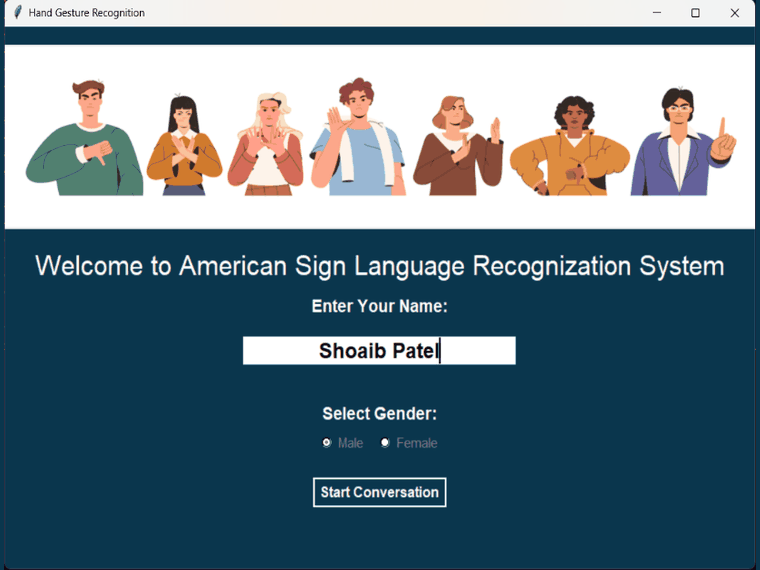
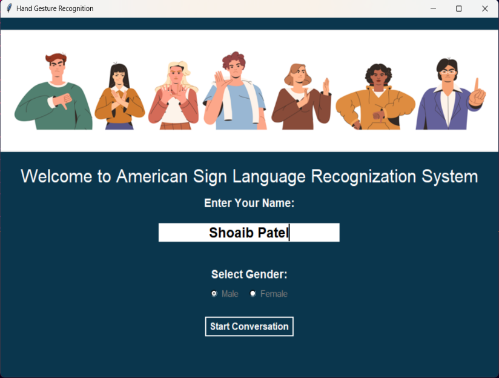
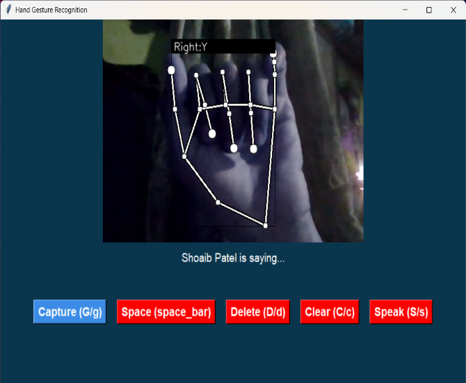

<div align="center">



<br>


<br><br>

**Sign the alphabet at your webcam. It types the letters, builds the sentence, and says it out loud.**

Runs offline on an ordinary laptop. No GPU, no internet, no cloud API.

</div>


## About

A person who is deaf or mute can sign fluently. Most people around them cannot read a single sign.
That gap is the whole reason this project exists.

This app sits in the middle of that conversation. It watches your hand through a normal webcam,
recognises the American Sign Language letter you are making, lets you stack those letters into words and
sentences, and then speaks the finished sentence in a male or female voice. The person on the other side
never has to learn a sign.

It was built as our final year B.Tech project in Computer Science & Engineering, and the approach behind
it was published as a review paper in IRJMETS in November 2024.


## Demo

<div align="center">



</div>

<table>
<tr>
<td width="50%" valign="top">

<p align="center"><sub><b>Start screen.</b> Your name is shown during the session and the voice you pick here is the one that speaks.</sub></p>
</td>
<td width="50%" valign="top">

<p align="center"><sub><b>Live recognition.</b> The hand skeleton is drawn on the frame and the predicted letter sits on the bounding box.</sub></p>
</td>
</tr>
</table>


## Features

| Feature | What it means in practice |
|---|---|
| **Real-time recognition** | The full ASL alphabet, A to Z, straight from a webcam feed |
| **Hand tracking overlay** | 21 landmarks, a bounding box, the detected hand and the predicted letter drawn live |
| **Sentence building** | Capture letters one at a time, add spaces, backspace a mistake, clear and start over |
| **Speech output** | The finished sentence is spoken aloud, with a male or female voice |
| **Keyboard driven** | Every action has a shortcut, because one hand is already busy signing |
| **Fully offline** | Nothing leaves the machine. The model is 25 KB and runs on CPU |


## How it works

<div align="center">



</div>

The trick is that raw camera pixels never reach the neural network.

**MediaPipe Hands** locates the hand and returns 21 landmarks as (x, y) pairs. Those points are then
re-expressed relative to the wrist and normalised, so the same sign produces roughly the same numbers
whether your hand is close or far, left or right, big or small. What the classifier finally sees is just
42 numbers.

That is why the model can be tiny and still keep up with a live video feed. MediaPipe has already solved
the hard vision problem; the network only has to learn the shape of each letter in landmark space.

### The model

```
Input (42)
   |
   +-- BatchNormalization
   +-- Dense 128   mish   L2 0.01   -> Dropout 0.5
   +-- Dense  64   mish   L2 0.01   -> Dropout 0.5
   +-- Dense  32   mish   L2 0.01
   +-- Dense  26   softmax
```

Optimiser Adam, sparse categorical crossentropy, up to 1000 epochs with early stopping (patience 20).
Exported to TFLite with default quantisation, which is the 25 KB file the app actually loads.

### Results

| Measure | Value |
|---|---|
| Dataset | ~36,400 landmark samples we recorded ourselves |
| Classes | 26 (A to Z) |
| Split | 75 / 25 train / test |
| Test accuracy | **~86%** on the held-out split |
| Model size | 235 KB Keras, 25 KB quantised TFLite |

Most of the remaining error sits between letters that look nearly identical as still poses, M, N, S and T
in particular. The confusion matrix in the notebook shows exactly where.


## Quick start

```bash
git clone https://github.com/<your-username>/<repo-name>.git
cd <repo-name>
python -m venv venv
venv\Scripts\activate          # Linux or macOS: source venv/bin/activate
pip install -r requirements.txt
python app.py
```

You need **Python 3.9** and a webcam. On Windows you also need the Visual C++ Redistributable, and on
Linux you need `python3-tk` plus `espeak` for the voice.

Full walkthrough, including how to start it again on later days and what to do when something breaks:
**[SETUP.md](SETUP.md)**.

### Controls

| Key | Button | Action |
|:---:|---|---|
| `G` | Capture | Adds the letter currently on screen to the sentence |
| `Space` | Space | Adds a space between words |
| `D` | Delete | Removes the last character |
| `C` | Clear | Wipes the sentence |
| `S` | Speak | Reads the sentence out loud |

The prediction updates on every single frame, so nothing is committed until you press `G`. Hold the sign
steady, wait for the label to settle, then capture.


## Project structure

```
app.py                                  Tkinter UI, camera loop, recognition, speech
keypoint_classification.ipynb           Training and evaluation notebook
requirements.txt                        Python dependencies
SETUP.md                                Installation and day-to-day run guide

model/keypoint_classifier/
    keypoint.csv                        Landmark dataset, ~36k samples
    keypoint_classifier_label.csv       Class labels, A to Z
    keypoint_classifier.py              TFLite inference wrapper
    keypoint_classifier.keras           Trained Keras model
    keypoint_classifier.tflite          Quantised model used at runtime

utils/cvfpscalc.py                      FPS counter
assets/                                 Banner and loading animation
docs/                                   README images and diagrams
```


## Known limitations

Worth being honest about these.

- **Static alphabet only.** J and Z need motion in real ASL. Here they are judged on hand shape alone, so
  they are the least reliable letters.
- **Lighting matters.** A dim room, or a background the same colour as your hand, and detection suffers.
- **One hand at a time** gives the cleanest results, even though the tracker is configured for two.
- **Letters, not words.** The app spells out sentences. It does not recognise word-level signs or grammar.
- **System voices.** Speech quality is whatever your operating system provides.


## License

MIT. See [LICENSE.md](LICENSE.md).

<div align="center">
<br>

<sub>Built to make one conversation easier.</sub>
</div>
